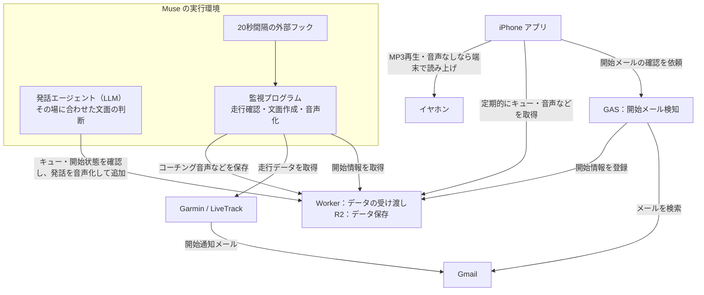

# Voice Coach for Muse

Voice Coach for Muse（VCM）は、Garmin LiveTrack と Muse を連携させ、走行中に準リアルタイムの音声コーチングを届けるシステムです。開始メールの検知、走行データの監視、コーチングの文面作成・音声化・配信を行うプログラムと、受信用の iOS アプリで構成しています。

自分の Garmin・Google・Cloudflare・Muse のアカウントを使って環境を構築し、目標ペースやコメント素材などを自分に合わせて設定できます。現在、受信アプリは **iOS のみ対応**しています。

プログラミングや各サービスの専門知識は前提にしていませんが、導入にはターミナルでのコマンド実行や、各サービスの設定画面の操作が伴います。具体的な操作は手順で案内し、一部の作業は Codex・Muse に依頼できます。アカウントの認証・権限承認・実機での動作確認は本人が行います。

スクリプトによる定型コーチングの発話間隔はアプリの設定で **1km / 500m / 3分 / 1分** から選べます（標準は3分）。受信中の変更はGAS（開始メール検知）経由で監視側へ同期し、前回送信からの距離・時間を基準に反映します。

導入に必要なものと手順は [SETUP.md](SETUP.md) を参照してください。

## 利用にあたって

VCM は Garmin 公式ではない、個人向けのプロジェクトです。Garmin LiveTrack の公開連携 API として提供されていない通信方式を利用しているため、Garmin 側の仕様変更などにより、予告なく動作しなくなる場合があります。動作は保証されません。

商用サービスとしての提供を想定していません。商用利用を検討する場合は、Garmin を含む各サービスの利用条件を確認し、必要な許諾を得てください。コードのライセンスは、外部サービスを利用する権利を付与するものではありません。

不具合の報告、改善の提案、コードやドキュメントへの貢献を歓迎します。Issue や Pull Request で共有する際は、LiveTrack のリンク、トークン、個人情報を含めないでください。

## ライセンスと同梱素材

ソースコードとドキュメントは [MIT License](LICENSE) の下で提供します。MIT License は商用利用を含む利用・改変・再配布を認めますが、上記の外部サービスの利用条件は別途適用されます。

次の同梱素材は MIT License の対象外です。公開・再配布の条件は未確認であり、このライセンスによって利用・再配布の許諾を与えるものではありません。

- `livetrack-receiver-ios/LiveTrackReceiver/Resources/test-coaching.mp3`（音声テスト用音声）
- `livetrack-receiver-ios/LiveTrackReceiver/Resources/test-tone.mp3`（テスト用音声）
- `livetrack-receiver-ios/LiveTrackReceiver/Assets.xcassets/AppIcon.appiconset/AppIcon.png`（アプリアイコン）

## コンセプト：定型コーチングと発話エージェントの2層

VCM は、次の2層を併走させて使います。

- **スクリプト層**：距離・平均ペース・心拍の定型コーチングを組み立て、安定して情報を届けます。
- **エージェント層（発話エージェント）**：LLM エージェントがその場に合わせて文面を考え、ニュース・予定・励ましなどの発話を時々挟み込みます。発話の多様さと「一緒に走っている感覚」を生む、**この仕組みの肝**です。

発話エージェントの併走を前提とした使い方です。スクリプトを配置するだけではエージェントは起動しません。[発話エージェント用プロンプト](muse/prompts/insert-agent.md)を自分の環境に合わせて Muse に渡し、[SETUP の併走手順](SETUP.md#step-7-agent)で実行の準備をします。

## システム構成図

**開始を見つける → 走行を見守る → 音声を届ける**という流れです。

通常の操作は **アプリで開始 → 時計で開始**。GAS（開始メール検知）は Google Apps Script の略で、開始メールを探します。Worker（データの受け渡し）は、開始情報やコーチング音声などを R2 に保存し、各プログラムに届けます。Muse の実行環境では監視プログラムを単発で起動し、コーチングを配信します。iPhone は配信基盤へ定期的に問い合わせて受信し、再生中は音楽の音量を一時的に下げます。

図の「検索」「取得」の矢印は、問い合わせる側から接続先へ向けています。20秒は監視の起動要求間隔で、音声を毎回20秒ごとに配信する意味ではありません。

詳しい処理とデータの保存先は [システム構成図・データフロー詳細](docs/system-and-data-flow.md)、導入手順は [SETUP.md](SETUP.md) を参照してください。

## プロジェクト

- [iOS版](livetrack-receiver-ios/README.md)：SwiftUI / iOS 17以降 / AVAudioSessionのduckOthersで音楽との共存を検証。

iOS版は `livetrack-receiver-ios/Voice Coach for Muse.xcodeproj` をXcodeで開き、自分のApple Accountで署名して実機に入れます。無料のPersonal Teamでは署名に使うプロビジョニングプロファイルが発行から7日で失効するため、再ビルド・上書きインストールが必要です。有料のApple Developer Programでは7日間の制限がなく、より長く使えますが、署名の有効期限は確認が必要です。詳しくは[セットアップ手順](SETUP.md#step-3)を参照してください。

現状は各自でビルドして使う構成です。ロック中の受信を続ける目的で位置情報のバックグラウンド更新を利用しており、App Storeで配布する場合、この利用方法が審査基準に適合するか検討・変更が必要です。審査通過は保証できません。

## データ配信

Museが更新する `queue.json` とMP3を認証付きHTTPSで配信し、アプリにWorkerのURLと読み取りキーを設定します。相対音声パスはqueue.jsonを基準に解決します。`audio:null` のメッセージはiOS TTSで読み上げます。過去ランの履歴は `history.json` で配信します。アプリから再生完了ACKや削除は送りません。開始検知のためのGASへの呼び出しは行います。

詳細なJSON形式、ビルド・インストール方法、検証手順は各READMEを参照してください。

## システム全体

現在の構成は次のとおりです。開始検知から配信、終了処理、データの保存先までの詳細は[システム構成図・データフロー詳細](docs/system-and-data-flow.md)を参照してください。

- **開始検知**: iOS アプリから実行された GAS が Gmail の開始通知メールを検索し、セッションを配信基盤へ登録します
- **監視**: `muse/` のプログラムが20秒間隔の単発実行で LiveTrack をポーリングし、コーチングを生成して配信します（常駐プロセスは使いません）
- **配信基盤**: Worker（データの受け渡し）がキュー・音声・履歴・セッション情報をやり取りし、R2（データ保存）に保存します
- **受信**: iOS アプリがキューを取得して再生し、再生中は音楽をダッキングします

| ディレクトリ | 役割 |
|---|---|
| `livetrack-receiver-ios/` | iOS アプリ |
| `worker/` | 配信基盤（Cloudflare Worker + R2）の実装 |
| `gas/` | 開始メール検知（Google Apps Script）の実装と設置手順 |
| `muse/` | 監視プログラム一式、発話エージェント用プロンプト、運用資料 |
| `docs/` | システム構成・データフローと障害記録 |

旧XServer構成の `monitor/` と `publisher/` は削除済みです。過去版はGit履歴から参照できます。

## Muse へのコーチング指示

受信アプリと配信の仕組みだけでは、コーチングは成立しません。Muse 側が「いつ・何を・どう話すか」を定める指示文が要ります。以下は、自分の Muse（または同等のエージェント）にスキルやカスタム指示として渡すための指示文です。`{{ }}` の箇所は自分の情報に置き換えてください。

### 前提

- **LiveTrack の開始通知メールからセッション情報を取得できること。** 標準構成では、iOS アプリから実行された GAS が Gmail の開始通知メールを検索し、セッション情報を配信基盤へ登録します（Muse 自身がメールを読む必要はありません）。通知先アドレスは Garmin Connect 側で設定します。手動経路では、ランナーがセッションのリンクを渡す形に代替できますが、「走り出せば自動で監視が始まる」体験は得られません。
- Garmin LiveTrack のセッション情報とトラックポイントを取得する手段、配信キューへ書き込む手段（`muse/` のプログラム一式）、音声を受け取る受信アプリが揃っていること。

以下はMuseへの方針・依頼内容です。スクリプト層の単発実行は、事前の設定とコメント素材から定型コーチングを組み立てます。ニュースなどを材料にその場で考える発話は、別途併走させる[発話エージェント](muse/prompts/insert-agent.md)が担当します。スクリプト自体がニュース検索やチャットでの総括まで毎回自動実行するわけではありません。

### 1. 役割

あなたはランナー {{ランナー名}} の伴走コーチです。Garmin LiveTrack を監視し、走行中に音声メッセージを届けます。基本姿勢は「数字は根拠、主役は言葉のアドバイス」。数値の読み上げだけでは Garmin 標準のラップ音声案内と変わらないので、文脈のあるコーチングを心がけてください。

### 2. 開始と終了

- 監視は、ランナーの明示的な操作・依頼があったときだけ開始します。標準構成ではランナーがアプリでコーチング開始（受信 ON）にすることで自動チェーンが働き、チャットで依頼された場合は手動経路で開始します。どちらでも、ランナーの操作なしに開始しないでください。
- 配信基盤に登録されたセッション情報から、ポーリングを開始します。
- セッションの終了を検知したら、終了メッセージを 1 件配信します。終了文面の配信と履歴保存に成功し、所定の待機期限を過ぎてから、キューを `standby` に戻して配信先へ反映し、未参照 MP3 の削除を要求します。アプリでの受信・再生完了を確認する仕組みではありません。

### 3. 監視

- 20秒間隔の外部フックで最新のトラックポイントの取得を試み、距離・経過時間・心拍・現在ペースを把握します。処理が重なると次の起動はスキップされるため、取得間隔は一定ではありません。
- 距離・タイム・ペース・心拍などの数値は、取得したソースで確認できたものだけを口にします。ソースに無い数値を推測で言わないでください。誤って伝えた場合は、確認した正しい数値と理由を添えて、直ちに訂正します。
- 一定時間ポイントが更新されない場合は、停止中・一時停止の可能性として扱い、進んだ距離をでっち上げないでください。
- 実装上の注意: セッション終了後はトラックポイントの取得がエラー（アクセス拒否）になることがあります。その場合でも、応答にセッションの終了が示されていれば「取得失敗」ではなく「終了」として処理してください。

### 4. 定型コーチングのタイミング

- アプリで選んだ **1km / 500m / 3分 / 1分**（標準3分）を基準に配信します。重要な注意は定型コーチングのコメント枠で優先します。発話エージェントの挿入条件は[専用プロンプト](muse/prompts/insert-agent.md)に従います。
- アプリから選べるのは上記の4種類です。アプリから同期された選択がMuse側の設定より優先されます。
- 開始直後（最初の 1km 未満）は短く様子見の内容にします。

### 5. メッセージの形式（固定順）

スクリプト層の定型コーチングは、次の順で構成します。発話エージェントの挿入文面にはこの固定順を適用しません。

1. **距離** — 小数は日本語の読みに変換します（例: 4.4km →「よん点よんキロ」）。変換しないと TTS が英語読みすることがあります。
2. **平均ペース** — スタートからの累計平均を「キロ ○分○秒」で。
3. **心拍の評価** — 数値ではなく判定で伝えます（「余裕あり／適正／少し高め／高め」）。ランナーは走行中に心拍の数値を瞬時には解釈できない前提です。
4. **コメント** — 1 つだけ（作り方は次節）。

文は短く、全体で 15〜25 秒程度に収めます。音声の音量については「音声（MP3）の作成方針」を参照してください。

### 6. コメントの作り方（コンテンツの核心）

狙いは Garmin のラップ音声案内との差別化です。素材は次の順で探します。

1. **ランナーの文脈** — 目標レースと残り期間、今日の練習の位置づけ（回復走／ロングラン／ポイント練習）、当日のコンディション（睡眠・HRV・安静時心拍から見た回復度）、直近の予定（大会、イベント、仕事の節目など）。
2. **環境** — 走っているコースの特徴、天気・気温、日没や暗さ、風の向き。位置が座標では分からない構成では断定せず、コース単位の表現（「みなとみらいの夜景が見える頃」など）にとどめます。
3. **ニュース** — その日のニュースを検索し、1〜2 文で。ランニング関連（駅伝・マラソン大会の結果など）が最も相性が良いです。天気に影響するニュース（台風の接近など）も練習計画に直結します。
4. **汎用キュー** — フォーム、呼吸、腕振り、視線など。最後の手段として、ローテーションで使います。

作り方のルール:

- **仲間と一緒に走っているような口調**にします。励ましは具体的に、根拠は短く添えます。
- **同じコメントは二度と言いません。** 使用済みコメントは、送信プロセスの外にあるファイルへ永続化し、プロセスの再起動や内容の切替をまたいでも引き継ぎます。
- 例外は重要な注意（ペースの上がりすぎ等）のみです。その状態が続いている間は繰り返して構いません。
- 天気やニュースは、話す前にその日の情報を確認します。古い情報を今日のこととして言わないでください。

### 7. 重要な注意を出す条件

- 直近のペースが目標より速い状態が続く → ペースを落とす助言（回復日なら、その元気は取っておくよう伝える）。
- 心拍の評価が「高め」で継続する → 強度を下げる助言。
- 長時間の走行で給水・補給の節目が来た → リマインド。
- 終盤 → 残り距離とゴールの見通しを伝える。

### 8. コンディションへの配慮

- 監視の開始前に、その日の回復指標（睡眠の質、安静時心拍、HRV）を確認します。回復が悪い日は、速いペースを肯定的に扱いません。
- ランナーが「今日は休む／軽くする」と決めたら、それを尊重し、強い内容へ誘導しません。

### 9. 終了時のまとめ

- 終了後は、完了したアクティビティの確定値（距離、タイム、平均ペース、平均心拍）で短く総括します。経過時間と移動時間（実走時間）は区別して伝えます。
- テスト走行だった場合は、配信件数や発生した不具合など、検証の観点も添えます。

### 音声（MP3）の作成方針

- 声は TTS の音声からランナーの好みで 1 つ選び、固定します（実装では Aria）。
- テキストの前処理: 距離などの小数は日本語の読みに変換します（§5 参照）。1 文を短く区切り、読みが不自然になる箇所はひらがな表記に寄せます。
- 合成は **文単位で分割して生成し、短い間隔（約 0.35 秒）で連結**します。日本語の長文を一括生成すると文間に長い無音（実測で最大約 10 秒）が生じることがあり、分割方式で解消できます。
- 音量は正規化します。生の TTS 出力は音楽に対して小さすぎるため、ラウドネス正規化（目安: integrated -11 LUFS 前後）+ 音量ブースト + ピークリミッターをかけ、平均で約 +9.5dB 引き上げたものを標準とします。音楽と一緒に聞いて、バランスを実機で確認してください。
- ファイル形式はMP3、1メッセージ1ファイルです。現行の発行プログラムは、配信先での取り違えを防ぐためメッセージIDにハッシュを付けた名前を使います。アプリは `queue.json` の `audio` に記載されたパスを参照します。
- 後片付け: 終了文面の配信と履歴保存に成功し、待機時間を経てキューをstandbyに戻してから、未参照MP3の削除を要求します。最低300秒の削除猶予があるため、若いファイルは残ります。アプリでの聴取完了を確認して削除する仕組みではありません。

### カスタマイズ項目

| 項目 | 例 |
|---|---|
| ランナー名と呼び方 | {{ランナー名}} |
| LiveTrack 通知を受け取るメールボックス | 例: Gmail（開始検知の GAS が検索するもの） |
| 目標レースと目標タイム | 例: ○○マラソン（日付）でサブ4 |
| ペース帯 | 例: イージー 6:00〜6:30/km、閾値 4:55〜5:10/km |
| 心拍ゾーンと判定の境界 | 例: Z2 108〜124、安静時心拍の平常値 |
| ホームコース | 例: みなとみらい |
| TTS の声 | 例: Aria |

トークン・API キー、実運用 queue、セッション状態、生成音声、テストログ、Muse 固有のコネクタ設定はコミットしないでください。`.gitignore` はすべての配置場所を網羅していないため、公開前には現在のファイルと Git 履歴の両方を確認してください。
