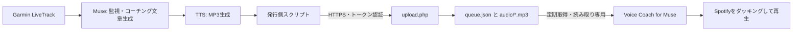

# Voice Coach for Muse

Museが生成したコーチングのJSONとMP3を受信・再生するiOSアプリと静的Webアプリです。

## プロジェクト

- [iOS版](livetrack-receiver-ios/README.md)：SwiftUI / iOS 17以降 / AVAudioSessionのduckOthersで音楽との共存を検証。
- [Web版](livetrack-receiver/README.md)：Vanilla HTML・CSS・JavaScript。ビルド不要。

iOS版は `livetrack-receiver-ios/Voice Coach for Muse.xcodeproj` をXcodeで開きます。実機利用時には自分のPersonal Teamを選んで署名してください。個人のTeam ID・証明書・プロビジョニングプロファイルは含めていません。

## 検証状況

2026-11-01、ユーザーの iPhone 実機で以下を確認しました。

- Spotify 再生中のダッキング（音量低下）と、音声終了後の音量復帰
- ロック画面での新着受信・再生
- 本番経路（discoverroutes.jp）での時刻配信テスト10件: 遅延は体感10〜15秒、ダッキングは毎回動作
- 本番経路でのコーチング文の配信テスト

Web版は同時再生には成功しましたが、音量低下が実現せず、割り込みモードではSpotifyが停止して自動復帰しませんでした。そのため Web 版は先行検証用と位置づけ、本番は iOS 版を使います。

## データ配信

Museが更新する `queue.json` とMP3をHTTP(S)で配信し、アプリにURLを設定します。相対音声パスはqueue.jsonを基準に解決します。受信専用で、サーバーへのACKや削除はありません。

詳細なJSON形式、ビルド・インストール方法、検証手順は各READMEを参照してください。

## システム全体

| ディレクトリ | 役割 |
|---|---|
| `livetrack-receiver-ios/` | iOS アプリ。既存の配置・機能・バンドル ID を維持 |
| `livetrack-receiver/` | 先行検証用の静的 Web 版 |
| `server/` | 本番と同一の upload.php のコピーと設置手順 |
| `publisher/` | Muse 原本の publish.py。init / say / sync / cleanup |

[サーバー設置・API](server/README.md)と[発行側の設定・使い方](publisher/README.md)を参照してください。発行スクリプトは収録済みです。監視・文章生成および TTS エンジン自体は外部の仕組みを利用します。

リポジトリは private のまま運用します。新たなトークン・API キー、実運用 queue、セッション状態、生成音声、テストログ、Muse 固有のコネクタ設定は格納しません。既存アプリに同梱されている音声テスト・デモ用 MP3 は動作を維持するため、そのまま残しています。
