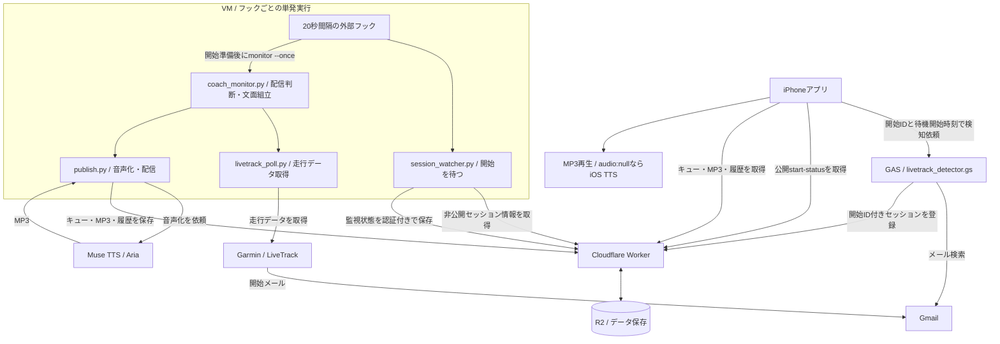
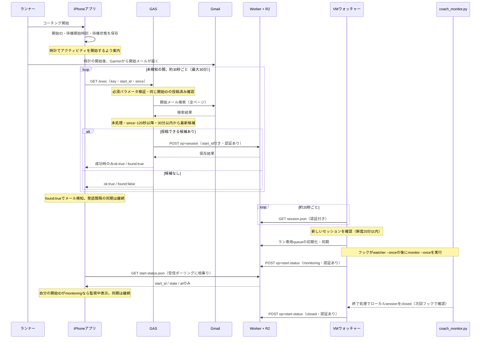
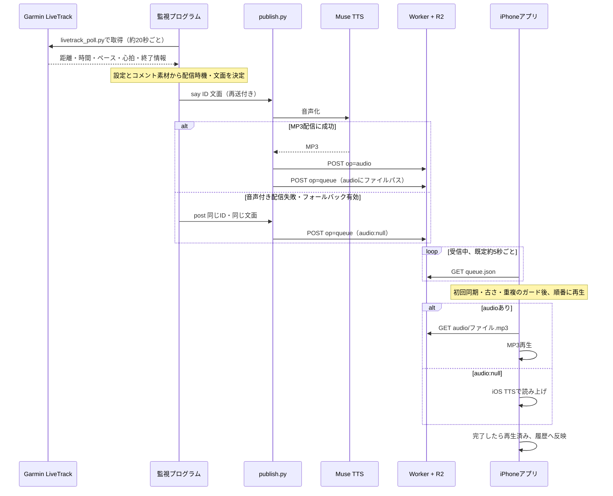
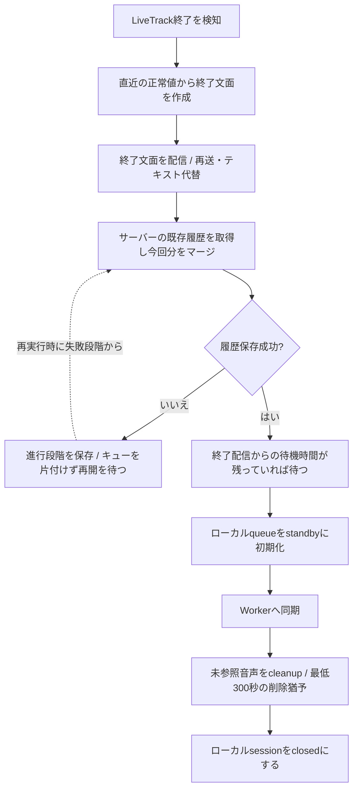

# VCM システム構成とデータフロー

作成日: 2026-11-04 / 更新: 開始ID方式・GAS予約名修正反映 / 対象コミット: 2c0b8b8 / アプリ: 1.4.2 (13)

現在のリポジトリの実装を基準にした説明。実際のVM、GAS、Workerにこの版が配置されていることを確認した図ではない。時間は既定値または代表値で、設定により変わる。

## 1. まず全体を理解する

VCM は「開始を見つける」「走行を監視して文面を作る」「届けて再生する」の3段階で動く。

- **GAS**: Gmailから開始メールを探す係。
- **VM上のPythonプログラム**: LiveTrackを読み、配信する文面を決める係。
- **Cloudflare Worker + R2**: 開始情報・配信キュー・音声・過去履歴を受け渡す置き場。
- **iPhoneアプリ**: 受信、再生、履歴表示をする係。
- **Muse**: 事前の設定・コメント素材の準備と運用・復旧を担当。走行中の配信ループにLLMは入らない。

矢印の「取得」は、矢印の出発側が通信を開始することを示す。WorkerがiPhoneやVMへ自発的に通知する構成ではなく、それぞれが定期的に問い合わせる。

## 2. 開始検知の流れ

通常操作は **アプリでコーチング開始 → 時計でアクティビティ開始**。
アプリは開始ID（UUID）と待機開始時刻を保存し、開始ボタンから直ちにキックする。
キュー取得や監視状態取得の完了を待たず、同じID・時刻で再試行する。

### キックの契約と候補選択

- `key`、`start_id`（UUID）、`since`（ISO 8601 UTC）が必須。欠落・不正ならエラーで、旧方式へ戻さない。
- **`sid` はGASの予約パラメータなので使用しない。** アプリは設定URLに残った旧 `sid` も取り除いて送信する。
- 候補はLiveTrack URLを抽出できる未処理メールのうち、受信時刻が `since - 120秒` 以降、かつ受信から30分以内の最新のもの。
- 120秒は時計ずれの許容幅。この範囲内の開始前メールも候補になり得る。
- `PROCESSED_MAIL_IDS` に直近20件の処理済みメールIDを保持。既存 `LAST_MAIL_ID` は移行時に取り込む。
- 同じ開始IDで投稿成功済みなら、`LAST_START_ID` / `LAST_START_SESSION_ID` の対応を使い、再投稿せず `ok:true, found:true, already:true` を返す。
- 別の開始IDでは、処理済みメールが見つかっただけで `found:true` にしない。投稿失敗も成功扱いにせず再試行する。
- GASの開始IDなし時間主導トリガーは使用しない。`scheduledCheck` はエラーとなる。`debugCheck` はテスト用UUIDと現在時刻を使い、実際に投稿し得る診断機能。

### アプリの待機と監視中表示

待機中にアプリを再起動しても、開始ID・開始時刻・待機状態・15分通知済みフラグを復元する。停止→再開始では新しいIDと時刻を生成する。

15分未検知で一度通知し、未検知のキックは元の開始時刻から最大30分。検知後・監視中は発話間隔を約30秒ごとに同期し、受信停止または自分の開始IDの `closed` でキャンセルする。任意の `speech_interval` は `per_km` / `per_500m` / `interval:180`。GASは同じ開始IDの設定だけを更新し、セッション再登録やキュー初期化は行わない。

**当日のqueue名はキック停止条件にしない。** 「監視中」の表示には、自分の開始IDに対応するstart-statusの `monitoring` が必要。GASの検知成功だけでは監視中と表示しない。これはVMがプロセスを起動した通知であり、その後の配信成功を保証するものではない。

検知設定がない場合、キックは無効。開始IDのない手動経路は残るが、その場合ウォッチャーはstart-statusを書かない。

### 設定とデプロイ

`WORKER_BASE` は必須。未設定なら認証済みのキックに `ok:false` と理由を返す。
Worker・VMを対応版にしてから、新アプリを配布し、GASを更新する。GAS更新後は、必須パラメータのない旧アプリでは検知できない。

GASは「デプロイを管理 → 既存デプロイを編集 → 新しいバージョン」で更新すれば `/exec` URLを維持できる。「新しいデプロイ」を作ると別URLになるため、アプリの検知URLも更新する。

## 3. コーチング配信の流れ

- 音声を直接iPhoneに送るのではなく、キューに音声の置き場所を記載する。
- フォールバックはサーバー側の音声付き配信失敗を受けて行う。iPhoneでMP3再生が失敗した場合の処理は、再試行・再初期化・エラー表示であり、自動的なテキストへの切替とは別。
- `audio:false` の運用では、監視から直接 `post` を使う。
- 同一session + IDの再送は置換。同一VM・共有保存先のpublisherはロックで直列化する。別々のVMからの同時更新は、この保護の対象外。
- iPhoneは初回同期時の既存メッセージ、約10分以上古いメッセージを自動再生しない。通知用TTSも同じ端末側にあるが、コーチング文面の生成は行わない。

### 開始検知と音声再生は別管理

開始IDは検知と監視状態の対応付けに使う。queueの再生可否は従来のsession＋メッセージID・再生済み管理・時刻で判断し、今回の開始IDでは絞り込まない。

そのため、受信開始時に前回の未再生かつ10分以内のメッセージが残っていれば再生される余地がある。「監視を開始しました」は監視プログラムが配信する文面であり、アプリ自身の開始通知「LiveTrack の開始を待っています」とは別。音声だけで今回の監視起動を判断しない。

ユーザーから今回のテストOKの報告あり。ただし、開始直後に「監視を開始しました」が流れた件は、過去の音声か新規配信か未確定として残す。

## 4. 終了と履歴保存

各段階の成功後に `finish_state.json` を保存する。終了文面・履歴・初期化・同期・cleanupのいずれかで失敗すれば、成功済みの段階を飛ばして再開する。図の再開矢印は履歴保存失敗の例。

通常終了と `finalize_run.py` による復旧は共通の `finish_run.py` を使う。待機は既定60秒で、履歴保存後にさらに必ず60秒待つという意味ではない。cleanupは若い音声を残すため、その時点ですべての未参照音声が消えるわけではない。

運用時の終了・復旧手順は [Muse のフック運用資料](../muse/HOOKS.md#実行状況の確認と終了復旧) を参照。

## 5. データはどこにあるか

| データ | 場所 | 書く側 | 読む側・用途 |
|---|---|---|---|
| 開始メール | Gmail | Garmin側 | GAS、手動開始経路 |
| session.json | R2 | GAS（Worker経由） | VMウォッチャー。開始IDとLiveTrack ID・トークンを含むため認証付き |
| start-status.json | R2 | VMウォッチャー（Worker経由） | iPhone。start_id / state / atのみ公開。LiveTrack ID・トークン・URLは含めない |
| 処理済みメールID・最後の開始IDとセッションの対応 | GAS Script Properties | GAS | 再投稿防止と同じ開始IDへの応答 |
| 開始ID・待機開始時刻・待機状態・通知済みフラグ | iPhone | iOSアプリ | キックの継続、再起動後の待機復元 |
| queue.json | R2 | publish.py（Worker経由） | iPhone。現在のsessionとメッセージ一覧。公開読み取り |
| audio/*.mp3 | R2 | publish.py（Worker経由） | iPhone。公開読み取り |
| history.json | R2 | publish.py（Worker経由） | iPhone。過去ランの文面。公開読み取り、直近10ラン程度 |
| session / poll / watcher / finishの状態 | VMローカル | 各Pythonプログラム | 監視の再開、終了処理の再開、最終正常値の保持 |
| queue・historyの控え、生成MP3 | VMローカル | publish.py | 配信作業と復旧。historyはサーバーの既存内容を取得して統合 |
| 使用済みコメント・診断ログ | VMローカル | 監視プログラムなど | 重複抑制、障害調査 |
| 再生済みID・ローカル履歴・設定 | iPhone | iOSアプリ | 再生管理、オフライン時の履歴表示 |

Workerは入口・認証・読み書きを担当し、データ本体はバインディング `QUEUE_BUCKET` で接続したR2に置く。書き込みは `X-Upload-Token` が必要。公開GETはキャッシュさせない設定。

iPhoneの履歴は「現在のqueueとローカル履歴」＋「history.json」を統合する。過去ランは再生対象にせず、historyが取得できない場合もローカル表示を続ける。再インストールで復元できるのはサーバーに保存された履歴であり、端末内の全状態が復元されるわけではない。

## 6. 補助プログラムの役割

| プログラム | 役割 |
|---|---|
| session_watcher.py | 単発の開始準備と終了状態反映。常駐モードはロールバック用に保持 |
| run_watch.py / wait_announce.py | Museから依頼して開始する別経路。メールを待ちながら待機音声を配信 |
| delivery.py | publisherの起動、タイムアウトの構造化、再送 |
| runtime.py | 状態の原子的保存、権限、ロック、破損ファイル退避 |
| configuration.py | 監視起動時の設定検証 |
| finish_run.py / finalize_run.py | 共通終了処理 / 停止した監視の終了復旧入口 |

## 7. 障害時に切り分ける境界

| 症状 | 順番に確認する境界 |
|---|---|
| 監視が始まらない | アプリの［開始検知］ログ・GAS URL・キー → start_id/since → GAS必須プロパティ → メール時刻 → Workerのsession → VM → 自分の開始IDのstart-status |
| 監視中なのに届かない | LiveTrack取得 → 配信判断とログ → publisherの成功結果 → Workerのqueue |
| カードはあるのに無音 | audioの有無 → MP3取得またはiOS TTS → アプリの再生状態・診断ログ |
| 終了後の履歴がない | finish_stateの段階 → history取得・マージ・保存の成功 → iPhoneのhistory取得 |

コードをGitHubへpushすることと、VM・GAS・Workerへ反映することは別作業。動作を調べるときは、配置済みの版も確認する。

診断ログの［開始検知］には、キック送信、HTTPエラー、ok/found、終了理由を記録する。URL・キーは記録しない。GAS実行一覧の「完了」は、アプリにok:trueが返った証拠にはならない。HTTPエラーとGASのJSON応答を区別して確認する。

ウォッチャーのstart-status送信は、session取得と同じUser-Agentを付与する（`2c0b8b8`）。本番でUA未指定のPOSTが403（1010）になったとの報告を受けた対応。状態送信失敗時は保留して後続の巡回で再試行する。

## フック単発実行への変更（2026-11-05）

現在の監視経路は外部フック → hook_once.sh → watcher --once → liveならmonitor --once。
20秒ごとに新しい認証環境で起動する。内部で常駐・sleepループは作らない。
coach_state.jsonに送信時刻・回数・イベント・実行途中の応答と送信結果を保持する。
終了処理の照合キーはキュー名で、待機期限前なら次回フックへ持ち越す。
新方式のmonitoringはプロセス常駐ではなく開始準備済みを表す。
[配置とロールバック](../muse/HOOKS.md)を参照。
